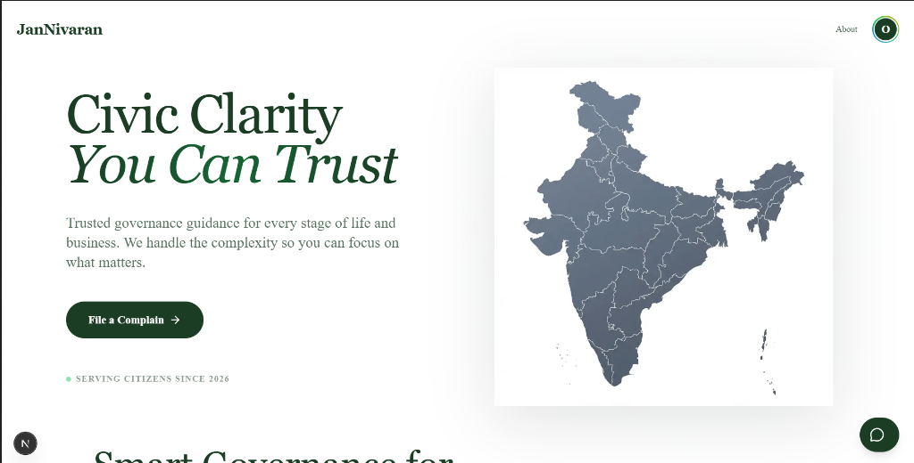
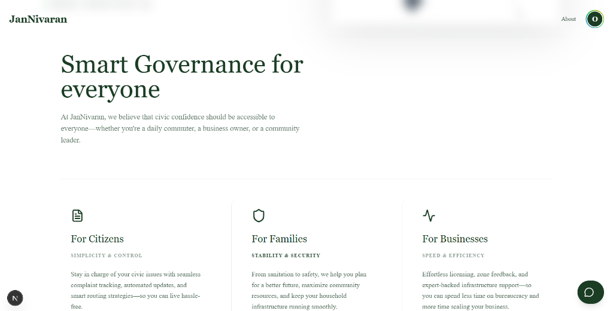
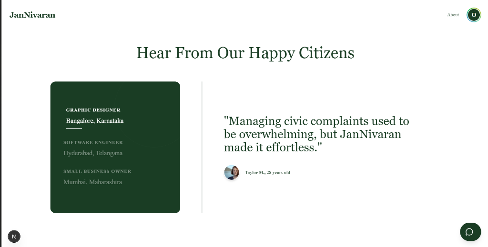

# 🏛️ JanNivaran - Citizen Grievance Redressal Portal

**JanNivaran** (Public Resolution) is a next-generation grievance redressal system designed to bridge the gap between citizens and administration. It provides a transparent, efficient, and AI-powered platform for filing, tracking, and resolving public complaints.


## 🌟 Key Features

### 👤 For Citizens
-   **Easy Complaint Filing**: Intuitive form with photo evidence upload (JPG/PNG/WebP, up to 3 photos × 5MB).
-   **Real-time Tracking**: Visual timeline of complaint progress (Pending → Under Review → In Progress → Resolved). Anyone with a tracking ID can see a redacted status view at `/track`.
-   **SLA Monitoring**: See transparent deadlines. If a complaint is overdue, it's visually flagged.
-   **AI Support Chat**: 24/7 AI assistant to guide you through the process.
-   **Instant Feedback**: "Rate Service" option upon resolution to ensure accountability.
-   **Control**: Withdraw a complaint while it is still Pending or Under Review (it is closed, not erased, so the audit trail survives).

### 👮‍♂️ For Officials & Admins
-   **Unified Dashboard**: High-level stats on Total, Pending, and Breached complaints.
-   **Automated Workflow**: Status updates to "Under Review" automatically when viewed.
-   **Simulation Engine** (development only): Simulate time passage (`+1 Hour`) and force SLA breaches on complaints marked `testData: true`. Disabled in production builds.
-   **Role-Based Access** (enforced server-side and in Firestore rules):
    -   *Officials*: See and work only complaints routed to their department (mark Under Review / In Progress).
    -   *Authority* (admin): All departments; exclusive rights to **Resolve/Close**, change **Priority**, **Assign**, and permanently **Delete** complaints.
-   **Smart Notifications**: Automated emails with timestamps for every status change.

### 🤖 Tech Stack
-   **Frontend**: Next.js 16, React 19, Tailwind CSS (Noble Dark/Forest Theme).
-   **Backend**: Next.js API Routes, Firebase Admin SDK.
-   **Database**: Google Firestore (NoSQL).
-   **Authentication**: Firebase Auth (ID tokens verified on every API call).
-   **File Storage**: Firebase Storage (complaint photo evidence).
-   **Email Service**: Nodemailer (SMTP).
-   **State Management**: React Context API.

## 🚀 Getting Started

### Prerequisites
-   Node.js 20+ (tested with Node 26)
-   Firebase project with Firestore, Authentication (Email/Password, Google) and Storage enabled
-   SMTP credentials for email (optional; without them emails are reported as `skipped`)
-   Java 21+ for the Firebase emulators used by the integration tests (e.g. `brew install openjdk@21`)

### Installation

1.  **Clone the repository**
    ```bash
    git clone https://github.com/OMgaupale1024/JANIVARAN.git
    cd JANIVARAN
    ```

2.  **Install dependencies** (reproducible, from `package-lock.json`)
    ```bash
    npm ci
    ```
    `.npmrc` sets `legacy-peer-deps=true` because `react-simple-maps@3` declares React ≤18 peers while the app runs React 19.

3.  **Environment Setup**: copy `.env.example` to `.env.local` and fill in your values. Never commit `.env.local` or service-account keys.
    -   `NEXT_PUBLIC_FIREBASE_*` — web app config from the Firebase console.
    -   `FIREBASE_PROJECT_ID`, `FIREBASE_CLIENT_EMAIL`, `FIREBASE_PRIVATE_KEY` — service account used by the API routes (Admin SDK). API routes return `503` if these are missing.
    -   `SMTP_*` — mail server. Set `EMAIL_OVERRIDE_TO` to a test inbox to redirect **all** outgoing mail during testing.

4.  **Deploy security rules and indexes** to your Firebase project (see [FIREBASE_SETUP.md](FIREBASE_SETUP.md)):
    ```bash
    npx firebase-tools@15.34.0 deploy --only firestore:rules,firestore:indexes,storage --project <your-project-id>
    ```

5.  **Create staff accounts**: sign up normally, then in the Firebase console set `users/{uid}.role` to `official` (plus `department`, e.g. `Water Department`) or `admin`. Roles can never be set from the app.

6.  **Run**
    ```bash
    npm run dev                       # development
    npm run build && npm run start    # production
    ```
    Citizen portal: [http://localhost:3000](http://localhost:3000) · Staff login: [http://localhost:3000/admin/login](http://localhost:3000/admin/login)

### Checks
```bash
npm run lint
npm run typecheck
npm test                # SLA / policy / validation unit tests
npm run test:emulator   # Firestore + Storage rules and API tests on local emulators (demo project, no real data)
```

## 🔐 Security Model

-   Browsers never write complaints. All writes go through API routes that verify the Firebase ID token and read the caller's role/department from the trusted `users/{uid}` record (never from the request body, query string or localStorage).
-   `firestore.rules` gives browsers read-only, scoped access for live dashboards: citizens their own complaints, officials their department, admins everything. Users can create only a `citizen` profile and can never change `role` or `department`.
-   `storage.rules` lets citizens upload images (≤5MB, JPG/PNG/WebP) only to `complaints/{their uid}/…`; the server re-checks owner, type and size before attaching evidence.
-   SLA deadlines are computed once at submission from the category and stored on the complaint; every dashboard reads that stored deadline.
-   **Withdrawal vs deletion**: a citizen may withdraw their own complaint while it is Pending or Under Review (status becomes `closed`, `closedReason: withdrawn-by-citizen`). Only an Authority may permanently delete; an audit record is kept.

## 📸 Screenshots

<div align="center">
  
  <p><em>Modern, accessible landing page for all citizens</em></p>
</div>

<div align="center">
  <h3>Features & Citizen Stories</h3>
  
  
</div>

## 🛡️ License

This project is licensed under the MIT License - see the [LICENSE](LICENSE) file for details.
